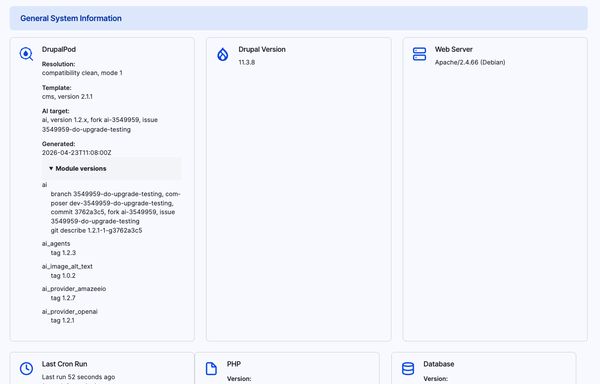

# `drupalpod_build_info`

This module exposes build information inside Drupal so users can see what was
actually resolved and checked out. You will find this information in the
Drupal status report after the environment is built at
`/admin/reports/status`.

It works with the generated build metadata to surface details such as:

- The resolved module versions
- The checked-out refs from the cloned repositories
- Build information shown in the Drupal status report
- The recorded resolution mode and compatibility result

## What It Does

- Reads the generated build metadata
- Displays the selected AI target and module versions
- Displays the recorded resolution mode and compatibility label
- Helps users confirm what was actually built into the environment

For the meaning of the mode numbers and compatibility values shown here, see
[Resolution Modes](../resolution-modes.md).

This is useful when you need to confirm the resolved Drupal version, AI target,
fork, branch, and module versions from inside the running site:

!!! info "Troubleshooting"
    This information is very useful when reporting DrupalPod AI QA build
    issues, because it shows what was actually resolved and built.

    When you log an issue, include a screenshot of this block from the status
    report:
    [Create a DrupalPod AI QA issue](https://www.drupal.org/node/add/project-issue/drupalpod_ai_qa)
