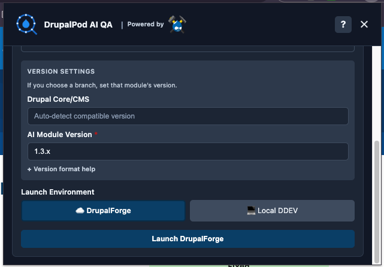
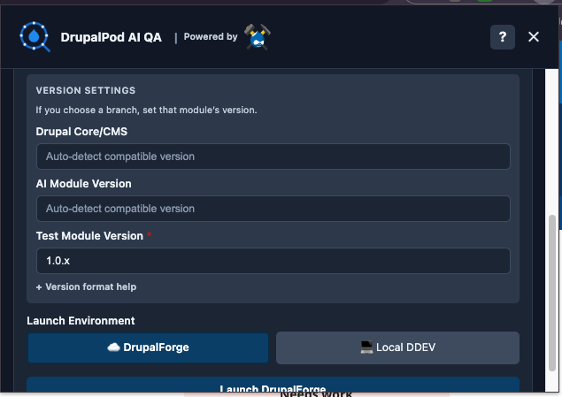
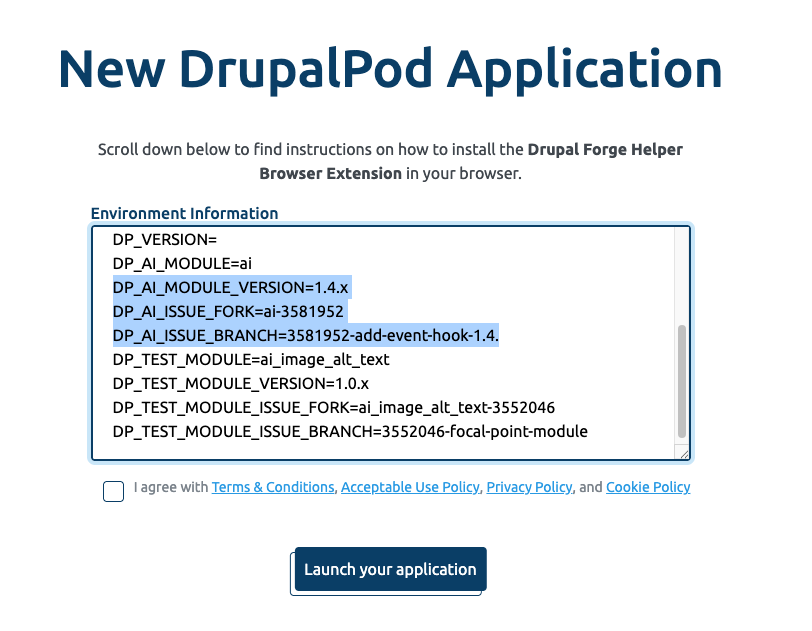
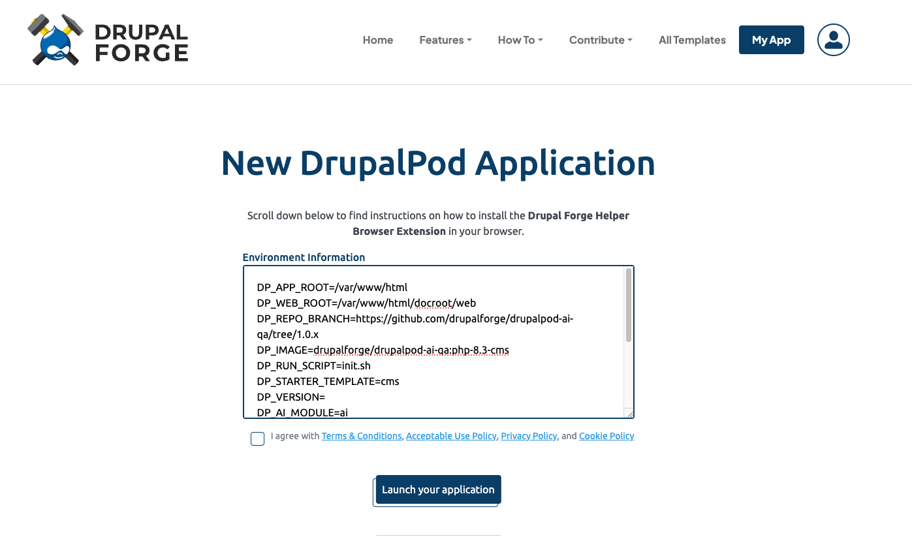

# Common Use Cases

DrupalPod AI QA can launch environments for several different kinds of AI issue
workflows.

In most cases, you are either:

- Testing an issue in the main AI project itself
- Testing another module against a specific AI base version
- Building a broader Drupal CMS and AI environment to explore modules

## 1. Test an Issue in the AI Base Project

This covers issues where the change being tested is in the main
[`ai`](https://www.drupal.org/project/ai) project itself.

Here, the environment is built around:

- A selected AI base version
- A specific AI issue fork and branch

Example:

- Test an issue in the main `ai` project on a specific AI fork and branch

## 2. Test Another Module Against an AI Base Version

This covers issues in a separate AI ecosystem module, such as
[`ai_image_alt_text`](https://www.drupal.org/project/ai_image_alt_text),
[`ai_agents`](https://www.drupal.org/project/ai_agents), or another contrib
module that depends on the `ai` project.

Here, you are testing:

- A specific module issue, branch, or fork
- Against a selected or auto-detected AI base version
- Optionally against a specific AI base fork and branch as well

Example:

- Test `ai_image_alt_text` or `ai_agents` against a specific AI base version such as `1.4.x` or `2.0.x`

This is useful when you need to answer questions like:

- Does this submodule still work with AI 1.4.x?
- Does this issue branch behave correctly against AI 2.0.x?
- Is the problem caused by the module itself, or by the AI base version it is running against?

??? info "Advanced: override both module and AI base values"
    If needed, you can override the generated DrupalForge variables so the
    environment uses both:

    - A custom module fork and branch
    - A custom AI base fork and branch

    This is useful for advanced compatibility testing when both the module
    under test and the AI base need to be pinned to specific work in progress.

    For this to work correctly, you usually need three AI base values from the
    issue you are testing:

    - The AI version the fork or branch is targeting
    - The AI fork name
    - The AI branch name

    In practice, you can usually get all three from the issue page or the
    related issue fork details.

    

## 3. Build a General AI Environment for Exploration

This covers cases where you do not need to test one specific issue branch, but
want a Drupal CMS or Drupal core environment with AI and a broader set of AI
ecosystem modules available.

Here, the environment is built around:

- A selected starter template such as `cms`
- The base [`ai`](https://www.drupal.org/project/ai) project
- Optional extra modules added through `DP_EXTRA_MODULES`

Example:

- Build a Drupal CMS environment with `ai`, `ai_search`, and `ai_image_alt_text` available for exploration

This is useful when you want to:

- try AI ecosystem modules together in one environment
- explore how a module behaves before working on a specific issue
- prepare a general-purpose QA or demo machine

In local or advanced hosted setups, `DP_EXTRA_MODULES` can be used to ask for
additional modules such as:

- `ai_search`
- `ai_agents`
- `ai_provider_amazeeio`
- `ai_image_alt_text`

Extra modules are checked for compatibility and may be skipped if they do
not match the resolved AI version. Currently, DrupalPod AI QA does not support
getting specific versions or forks of extra modules, but that is a potential
future enhancement.

If you want a generic DrupalForge launch URL for this kind of environment, you
can start here and manually fill in the missing values:

<a href="https://www.drupalforge.org/drupalpod?env_variables=DP_APP_ROOT%3D%252Fvar%252Fwww%252Fhtml%2CDP_WEB_ROOT%3D%252Fvar%252Fwww%252Fhtml%252Fdocroot%252Fweb%2CDP_STARTER_TEMPLATE%3Dcms%2CDP_VERSION%3D%2CDP_AI_MODULE%3Dai%2CDP_AI_MODULE_VERSION%3D%2CDP_AI_ISSUE_FORK%3D%2CDP_AI_ISSUE_BRANCH%3D%2CDP_TEST_MODULE%3D%2CDP_TEST_MODULE_VERSION%3D%2CDP_TEST_MODULE_ISSUE_FORK%3D%2CDP_TEST_MODULE_ISSUE_BRANCH%3D%2CDP_EXTRA_MODULES%3Dai_search%252Cai_agents%252Cai_provider_amazeeio%252Cai_image_alt_text%2CDP_REPO_BRANCH%3Dhttps%253A%252F%252Fgithub.com%252Fdrupalforge%252Fdrupalpod-ai-qa%252Ftree%252F1.0.x%2CDP_IMAGE%3Ddrupalforge%252Fdrupalpod-ai-qa%253Aphp-8.3-cms" target="_blank" rel="noopener noreferrer">Open a generic DrupalForge environment</a>
