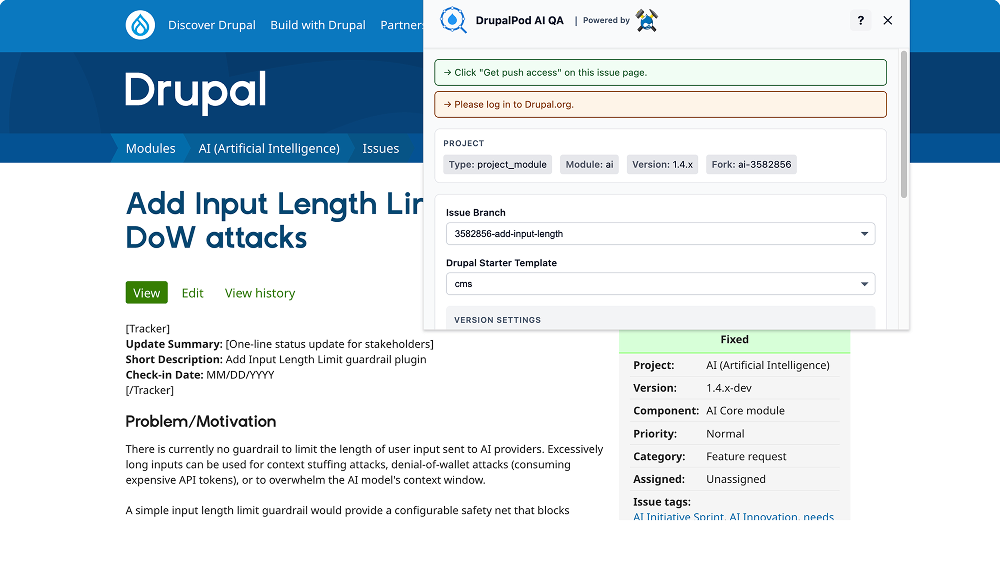
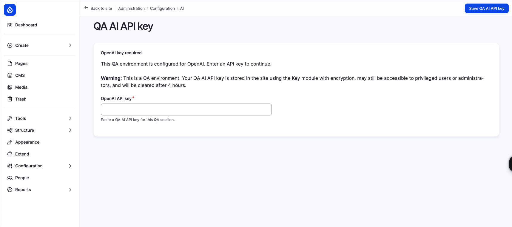
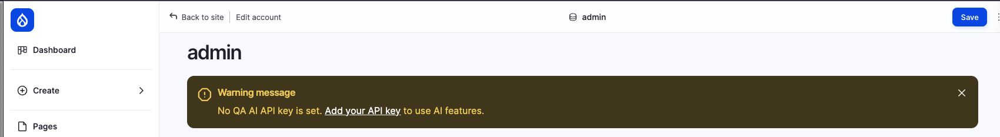
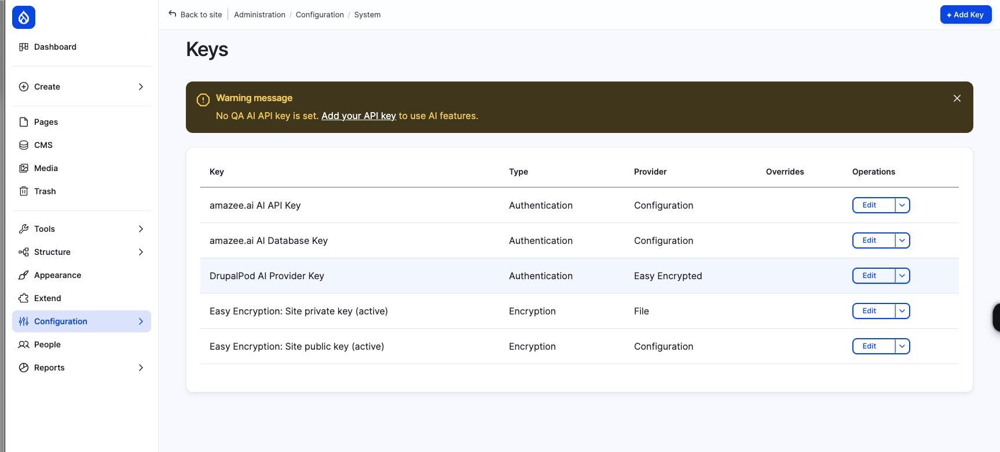

# Choosing an AI Provider

DrupalPod AI QA can prepare environments for different AI providers.

The main variable for this is `DP_AI_PROVIDER`.

Supported values are:

- `openai`
- `anthropic`
- `amazee` *(default)*

In the hosted flow, the extension gathers issue context and launch settings
before the environment is generated:



## What This Changes

The selected provider affects how the environment is prepared and how AI access
is configured inside Drupal.

### `openai`

- Uses the `ai_provider_openai` module
- Uses the DrupalPod AI QA temporary key flow inside Drupal
- Prompts for a temporary QA key when needed

### `anthropic`

- Uses the `ai_provider_anthropic` module
- Uses the DrupalPod AI QA temporary key flow inside Drupal
- Prompts for a temporary QA key when needed

### `amazee`

- Uses the `ai_provider_amazeeio` module
- Uses the provider's native provisioning flow
- Does not use the same temporary QA key prompt flow as `openai` and `anthropic`

For QA-managed providers such as `openai` and `anthropic`, Drupal may prompt
for a temporary QA API key after launch:



If no temporary QA key has been added yet, Drupal shows a warning to users who
can administer AI providers:



After a key has been saved, it appears in the site's key list as the
`drupalpod_ai_qa` key:



## In the Chrome Extension / DrupalForge Flow

In the standard hosted flow, provider setup happens as part of the generated
environment rather than as a separate extension control.

If provider-specific overrides are needed, they have to be applied through the
generated environment variables rather than through a dedicated provider picker
in the extension UI.

## In Local DDEV

Set `DP_AI_PROVIDER` in `.ddev/config.drupal.yaml` under `web_environment`.

Example:

```yaml
web_environment:
  - DP_AI_PROVIDER=anthropic
```

Then restart the environment:

```bash
ddev restart
```

## Related Variables

Provider selection often goes together with:

- `DP_AI_MODULE_VERSION`
- `DP_AI_ISSUE_FORK`
- `DP_AI_ISSUE_BRANCH`
- `DP_TEST_MODULE`
- `DP_TEST_MODULE_VERSION`

For the full variable list, see
[Configuration Reference](configuration-reference.md).
