# Step-by-Step Guide

DrupalPod AI QA is an automation tool designed to simplify testing and
validation of AI module patches and pull requests in Drupal environments.

This guide covers using the DrupalPod AI QA Chrome extension with DrupalForge.

## Prerequisites

Make sure you have:

- Installed the [DrupalPod AI QA helper extension](https://chromewebstore.google.com/detail/drupalpod-ai-qa-helper-ex/nfemkgbmpcfibkpjifoaimldfjejinji) in Chrome
- Logged in to [DrupalForge](https://www.drupalforge.org/)
- Opened a [drupal.org](https://www.drupal.org/project/issues/) issue for the module you want to test

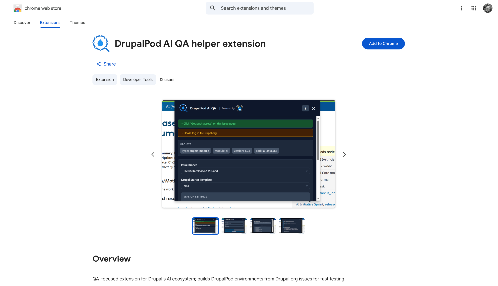

## Step 1: Open the Ticket

Navigate to the AI module issue you want to test, then open the Chrome
extension while you are on that ticket page.

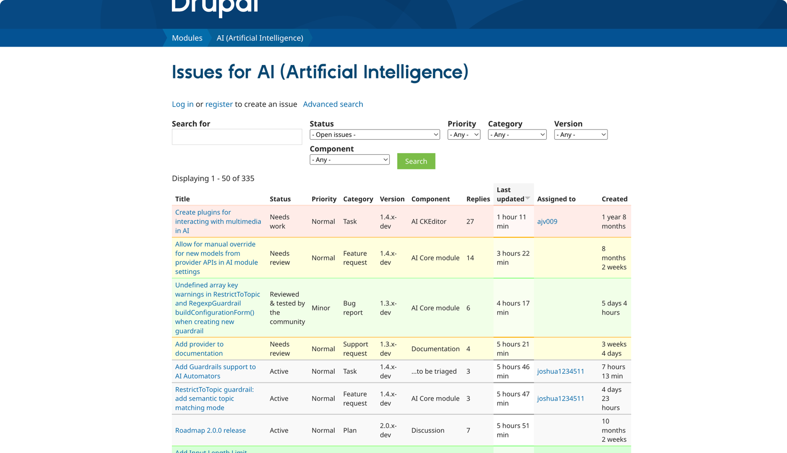

Open the specific issue you want to test:

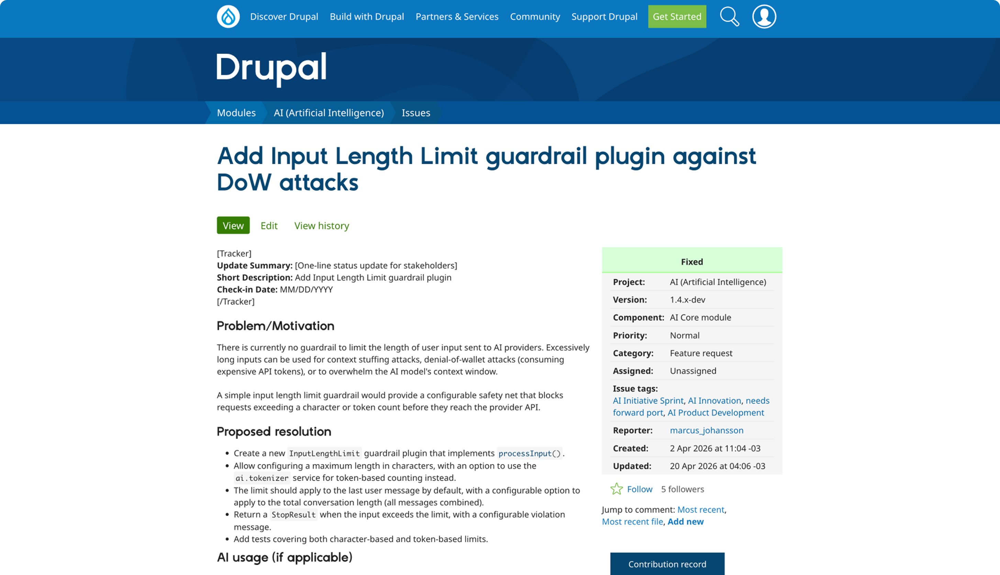

If the issue has an issue fork, click `Get push access` before launching:

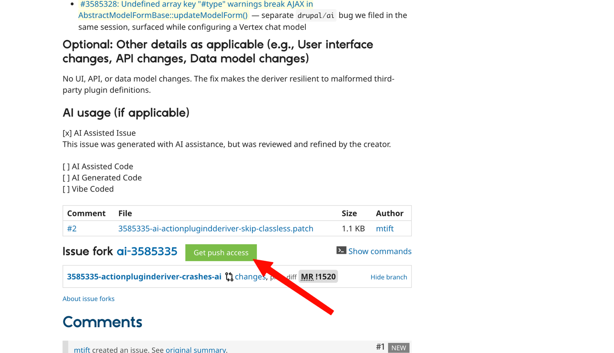

## Step 2: Configure the Environment

Inside the extension, review the environment variables before launch.

Most users will not need to change anything. In the standard flow, the
extension will populate the required values from the ticket context.

If you are not sure, leave the defaults alone and use the values generated by
the extension.

Scroll through the version settings and review the launch target:

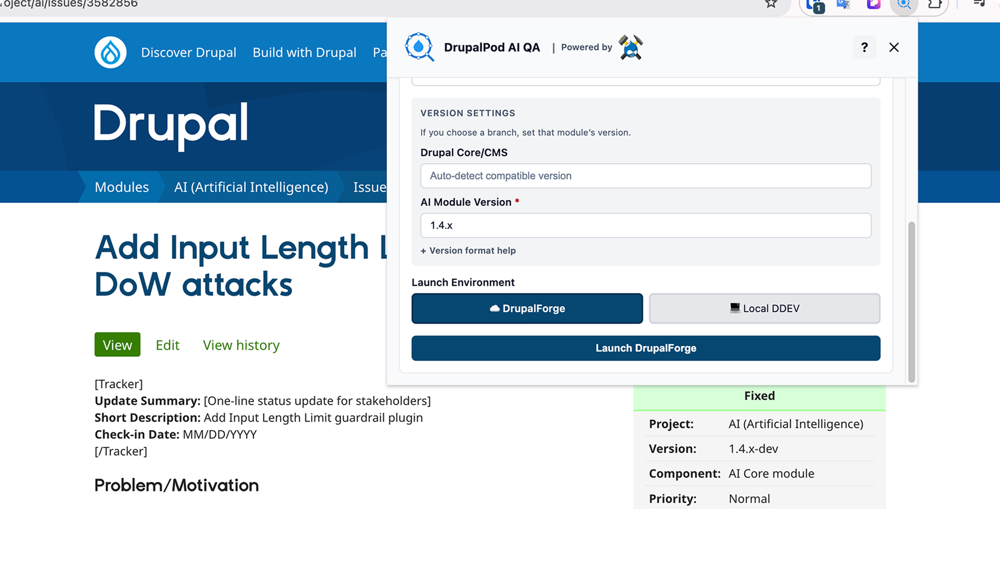

## Step 3: Choose Where to Build

Select the target environment:

- `DrupalForge` if you want a hosted environment
- `Local` if you want to run the project in DDEV on your machine

!!! info "Local DDEV option"
    The local option requires a manual setup step. See the
    [Local DDEV Guide](local-ddev-guide.md) for details.

For the DrupalForge path, make sure you are already signed in to [DrupalForge](https://www.drupalforge.org/) in another tab.
The extension will use that session to launch the environment.

When you are ready, click the launch button in the extension:

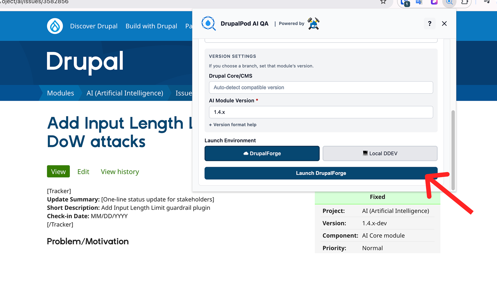

## Step 4: Review and Launch in DrupalForge

After clicking launch, DrupalForge will open a generated application screen.

!!! info "AI provider selection"
    In the standard workflow, DrupalPod AI QA uses
    [ai_provider_amazeeio](https://www.drupal.org/project/ai_provider_amazeeio),
    which gives you an auto-provisioned trial setup.  You can optionally set 
    `DP_AI_PROVIDER` to `openai` or `anthropic` and enter your own key. For
    more detail, see [Choosing an AI Provider](provider-selection.md).

At this stage:

1. Review the generated environment information
2. Confirm the required terms and policy checkbox
3. Click `Launch your application`
4. Wait for the environment to finish provisioning

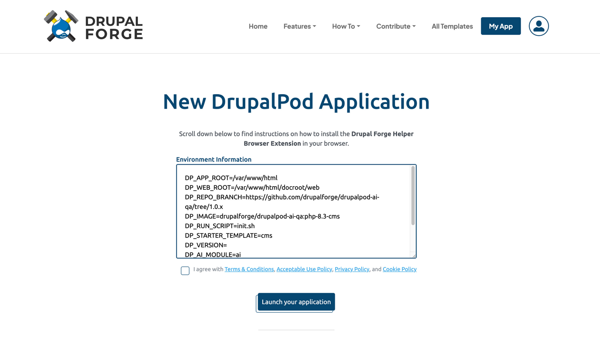

Check the required agreement box:

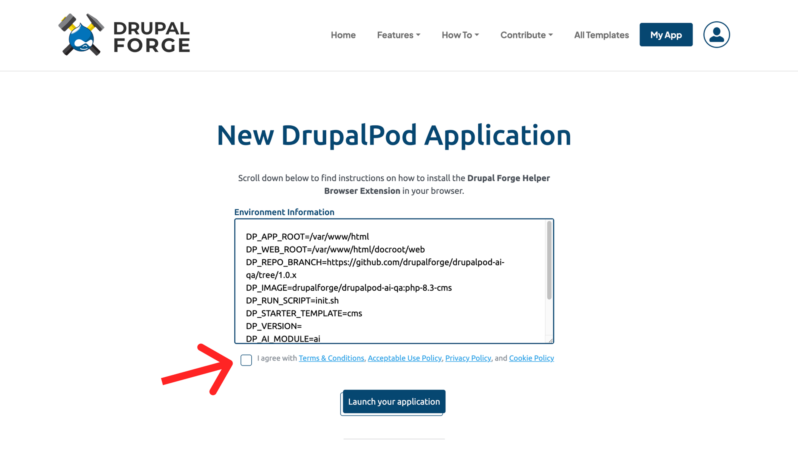

If prompted, log in to DrupalForge or DevPanel:

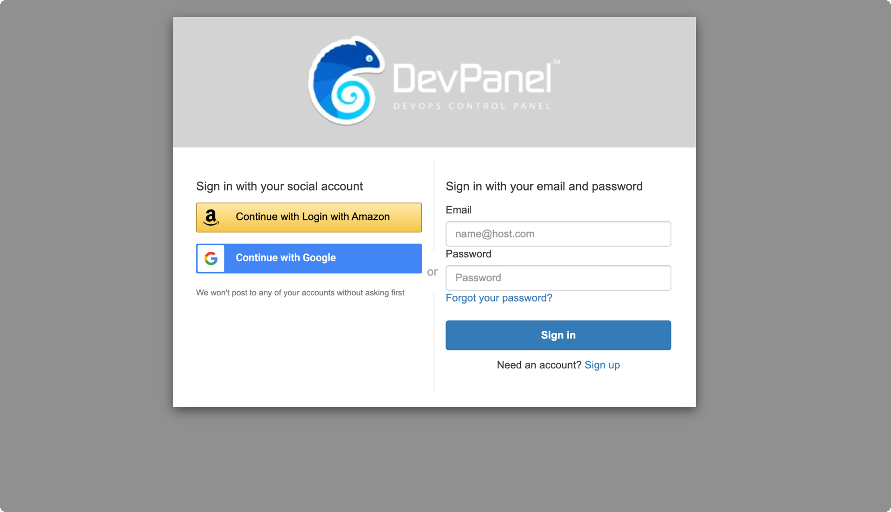

## Step 5: Wait for Deployment

After launch, the environment will enter deployment.

During deployment, you can monitor the status in DevPanel:

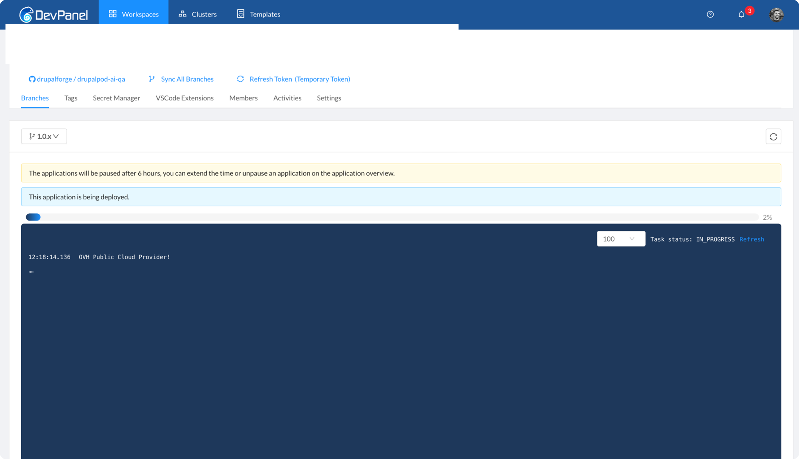

## Step 6: Access the Environment

Once deployment is complete, the DrupalForge dashboard will provide access to:

- The running site
- DevPanel controls
- An IDE for inspecting or editing the project code

Projects are expected to remain active for six hours.

After deployment is complete, the application summary and browser-based tools
will be available from the DevPanel overview:

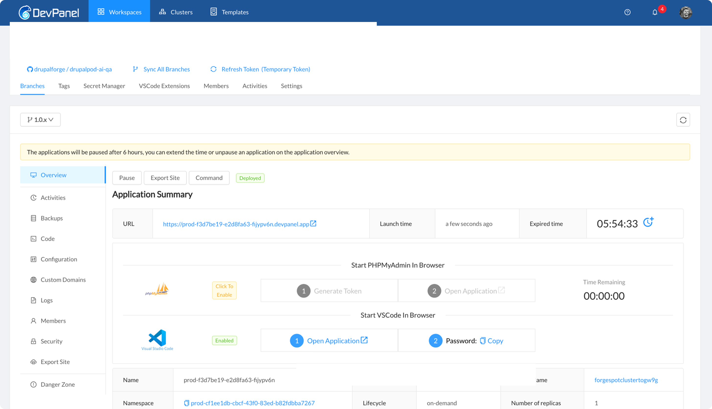

You can access your application by clicking the URL in the Application Summary. 
To log into admin, go to `https://[your-site].devpanel.app/user/login` and use
admin:admin credentials to log in.

And then your application is ready to use! You can start testing your issue
branch, or explore the codebase by using VS Code in the browser.

!!! warning "Public environment and AI provider credentials"
    DrupalPod AI QA environments should be treated as temporary shared environments 
    and are using insecure `admin:admin` credentials for the super admin user.

    If you want to use a provider that requires an API key, see
    [Choosing an AI Provider](provider-selection.md) for the DrupalPod AI QA
    temporary key flow and `DP_AI_PROVIDER` options. This will allow you to use
    your own key, and will auto-expire the key after a limited time window.

!!! info "VS Code in Browser"
    If you want browser-based VS Code access, go to the
    `Start VSCode In Browser` section, copy the generated password, open the
    application, and submit the password in the prompt.

    For the access steps, see
    [Working with Visual Studio Code in the Browser](vscode-in-browser.md).

If the site does not build correctly, see
[Troubleshooting](troubleshooting.md).
